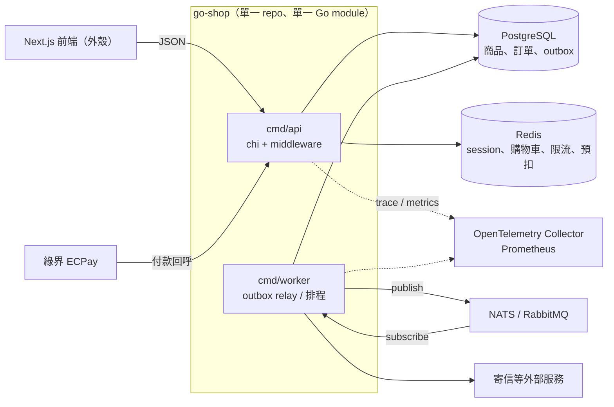
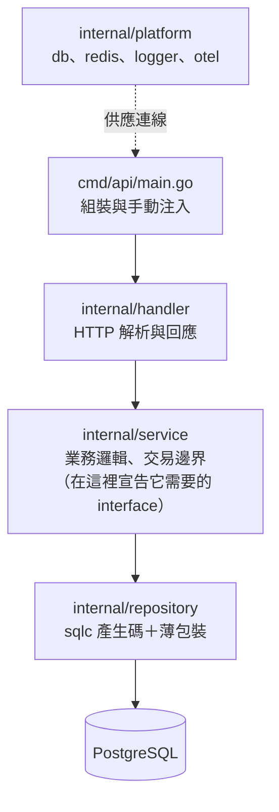

# 架構

目標是「實戰版」購物網站後端：單一 Go 服務（API + worker 兩個進入點），不拆微服務。
架構決策見 `state/DECISIONS.md`。

## 技術棧

| 面向 | 選擇 | 第幾集引入 | 為什麼 |
|---|---|---|---|
| HTTP router | chi | 01 | 貼近 `net/http`，middleware 就是 `func(http.Handler) http.Handler`；否決 Gin（自有 Context，離標準庫遠） |
| 專案結構 | `cmd/` + `internal/` | 01 | Go 社群慣例；`internal/` 由編譯器強制不可被外部 import |
| 設定與組裝 | 手動注入（在 `main` 裡 new） | 01 | Go 沒有內建 DI 容器；對照 ASP.NET Core 的 `IServiceCollection` |
| 日誌 | `log/slog` | 01 | 標準庫結構化日誌 |
| 資料庫 | PostgreSQL + pgx | 02 | pgx 是效能與功能最完整的 Postgres driver |
| 查詢 | sqlc | 02 | 寫 SQL、產生型別安全的 Go 碼；沒有 ORM，對照 EF Core |
| Migration | goose | 02 | SQL 檔為主，可嵌入二進位 |
| API 契約 | OpenAPI + oapi-codegen | 03 | 契約先行，產生 server interface 與型別 |
| Session／購物車／限流 | Redis | 04–05 | 跨實例共享狀態 |
| 交易與鎖 | Postgres 交易、`SELECT ... FOR UPDATE` | 06 | 防超賣；對照 `[Transactional]`／`TransactionScope` |
| 金流 | 自寫綠界回呼（`internal/payment/ecpay`：CheckMacValue 驗章、解析） | 07 | 冪等鍵防重複入帳 |
| 非同步 | outbox 表 + NATS（或 RabbitMQ）+ worker | 08 | 與業務交易同一個 DB 交易寫入，保證至少一次送達 |
| 排程與逾時 | `time.Ticker`、`context.WithTimeout` | 09 | 釋放逾時未付款的保留庫存 |
| 高併發搶購 | Redis 預扣 + channel 背壓 | 10 | 擋住 DB 前的流量 |
| 可觀測性 | OpenTelemetry（trace）+ Prometheus（metrics）+ slog | 11 | trace id 串 log |
| 生命週期 | graceful shutdown（`signal.NotifyContext` + `Server.Shutdown`） | 12 | 部署不斷線 |
| 測試 | table-driven、testcontainers-go、k6 | 全系列 | 單元、整合、壓測三層 |
| 部署 | 多階段 Dockerfile（scratch/distroless）→ docker compose → Azure Container Apps | 12 起 | 先本機再上雲 |
| 前端 | Next.js | 外殼 | 只負責展示，影片不細講 |

明確否決：Gin、gRPC 微服務、templ／htmx 伺服器端渲染。

## 元件圖



## 分層（API 內部）



規則：

- 依賴只能往下。handler 不碰 SQL，service 不碰 `http.Request`。
- interface 定義在使用端（service 宣告自己需要的 store），repository 回傳具體型別。

## 目錄（目標樣貌，逐集長出來）

```
cmd/
  api/          HTTP API 進入點
  worker/       outbox relay、排程（第 8 集起）
internal/
  handler/
  service/
  repository/
  platform/
api/            OpenAPI 規格（第 3 集起）
db/
  migrations/   goose（第 2 集起）
  queries/      sqlc 的 SQL（第 2 集起）
deploy/         Dockerfile、compose（第 12 集）
scripts/k6/     k6 腳本（第 6 集起）
web/            Next.js 外殼
docs/
```
